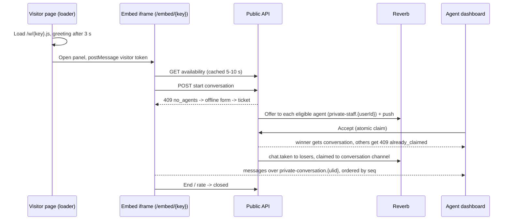
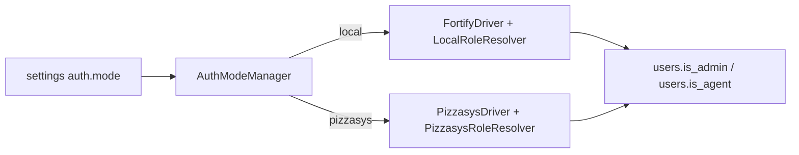
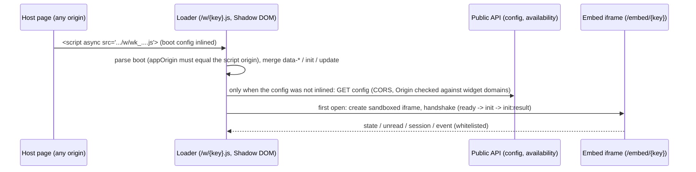

# Architecture

> Status: the structure and flows 2 and 3 (install gate, auth drivers) and the widget delivery flow 4 are implemented through P3; flow 1 (the chat itself) is design until P4.

## Style

Modular monolith on Laravel 13. Business logic lives in `app/Domain/<Context>/Actions` as single-purpose classes. Controllers are thin transports (Inertia, Management API, Public API, Webhooks). Eloquent models stay flat in `app/Models`. Only ULIDs / `public_key` values leave the server; integer primary keys never do. Events use `ShouldDispatchAfterCommit`. Tenant tables carry a nullable `workspace_id` so a SaaS mode is possible later (no tenant UI now: single org, many widgets).

## Contexts

| Context | Responsibility |
|---|---|
| Install | Install state, gate, wizard steps, runner, lock file |
| Settings | Typed, encrypted, Redis-cached settings |
| Auth (`app/Auth`) | `AuthModeManager`, `FortifyDriver`, `PizzasysDriver` (`app/Auth/Pizzasys`: client, gateway, circuit breaker, verify cache, external sessions), role resolvers, shadow users |
| Catalog | Categories (global; each widget picks which to show), agents' served categories |
| Agents | Staff directory, mode-aware account rules (`AuthModeGuard`) |
| Widgets | Widgets, domains, greetings, draft/publish config, origin matcher, identity verifier, boot-config resolver, availability |
| Visitors | Visitors, visitor sessions (hashed tokens), signed identity |
| Chat | Conversations, messages, routing, claim, state machine, attachments, ratings |
| Presence | Agent presence, heartbeat, availability |
| Notifications | Web Push, `PushChannel` interface, device tokens |
| WhatsApp | OpenWA sessions, webhooks, hand-off, admin-only inbox (never joined to `conversations`) |
| Analytics | Daily rollups |
| Audit/Outbox | Audit log, outbox events |

Adapters live in `app/Infrastructure/{OpenWa,Nats,Storage,Broadcasting}` (only `Nats` exists so far: the JetStream consumer behind `chat:auth:consume-nats`). Outbound address validation (`OutboundUrlGuard`) lives in `app/Support/Network`.

## Directory layout

```text
app/
  Auth/                      AuthDriver, managers, resolvers, Pizzasys/ (client, gateway, shadow sync, sessions)
  Console/Commands/          chat:install, chat:bootstrap-secrets, chat:auth:*
  Data/                      spatie/laravel-data classes with #[TypeScript] (shared payloads)
  Domain/<Context>/Actions/  single-purpose actions (+ Data/, Config/, Origin/, Identity/ ... per context)
  Http/Controllers/{Agents,Catalog,Embed,Settings,Setup,Widgets,Api/V1/{Public,Management}}/
  Http/Middleware/           InstallGate, EnsureSessionIsValid, EnsureChatAccess, EnsureAdmin, SecurityHeaders, Widgets/*
  Infrastructure/Nats/       NATS JetStream consumer (OpenWa, Storage, Broadcasting follow in later phases)
  Support/Network/           OutboundUrlGuard (SSRF guard for admin-typed addresses)
routes/        web.php + web/<ctx>.php, api/management/<ctx>.php, api/public/<ctx>.php, webhooks/<ctx>.php (loaded by RouteFiles)
resources/js/  pages, components, hooks, lib, nav, embed (the visitor chat panel), types
resources/widget/{src,test,dev}   vanilla-TS IIFE loader (<= 16 KB gz), its Vitest suites and a dev host page
public/widget/v1/loader.js        build output of `npm run build:widget` (git-ignored)
docker/  docs/  e2e/
```

Nav is built from `import.meta.glob('./nav/*.ts')` so parallel work tracks never conflict. Each context gets its own ServiceProvider and route file (created in P0).

## Flow 1: visitor to agent chat



(From the loader to the panel the flow is built and tested in P3; conversations, routing and realtime arrive in P4.) The widget opens no websocket until the visitor starts a chat. Eligibility is computed at request time: agents owning the category whose presence is `online` (then `away` after 20 s); queue timeout is 90 s, after which the request becomes an offline ticket. See [realtime.md](realtime.md).

## Flow 2: install gate

- `InstallAwareConfigProvider` forces `session=file`, `cache=file`, `queue=sync`, `broadcast=null` until installed, so nothing touches the database before install. `.env` holds the real drivers, which activate once the lock exists.
- `InstallGate` (global middleware) redirects web requests to `/setup`, returns `503 not_installed` for API calls, and exempts `/up`, `/setup/*` and assets.
- Lock: `storage/app/installed.lock` (authoritative) plus a DB flag. After the lock, `/setup/*` is 404 forever and `/` is `auth`-guarded.
- Takeover guard: one-time `SETUP_TOKEN` printed in the app logs (skipped only for `APP_ENV=local` requests from 127.0.0.1 / ::1 with no proxy headers). Non-interactive path: `chat:install --mode=local|pizzasys`.

## Flow 3: auth drivers



The app reads only `users.is_admin` and `users.is_agent`. In mode 1 they derive from the local role; in mode 2 they are derived from pizzasys roles on every verification. Details: [auth-modes.md](auth-modes.md).

## Flow 4: widget delivery and trust boundaries (P3)



- **Origin allow-list** (`widget_domains`) drives three things: CORS on the public API, `frame-ancestors` on `/embed/{key}`, and the panel's postMessage origin check (P4). Public delivery routes (`/w/{key}.js`, `/embed/{key}`, `/c/{key}`) run **without** the web middleware group: no session, no cookies.
- **Config lifecycle:** the dashboard saves a *draft* config; Publish makes it the visitor-facing config (`config_version` + 1) and busts the widget's cache namespace. Greetings, domains, category links and the operational settings columns are live as soon as saved. The resolved boot config is built from the published config only and cached per widget revision.
- **Rate limits** are layered: per client network across keys, a tighter budget for unknown keys, then per widget and allowed origin (`config/chat.php`); a 429 stays readable by the page that was allowed a moment ago.
- Security controls in one place: [security.md](security.md).

## Cross-cutting rules

- Dashboard uses Inertia for pages/settings and the Management REST API for live-chat operations, so one API serves web and the future mobile app ([rest-api.md](rest-api.md)).
- WhatsApp is an admin-only domain, never joined to `conversations` ([whatsapp-openwa.md](whatsapp-openwa.md)).
- Widget is a Shadow-DOM launcher plus a React iframe panel; no cookies at all ([widget-embed-api.md](widget-embed-api.md)).
- Every `api/*` error is the envelope `{error:{code,message,details?}}` (`ApiErrorRenderer`; expected failures throw `ApiProblemException`). Dashboard pages carry baseline security headers (`SecurityHeaders`).
- Contracts (Inertia shared props, event payloads, REST shapes, postMessage protocol, widget config, auth) live in `docs/contracts/*`, written before parallel tracks start and updated to the implemented truth afterwards.
