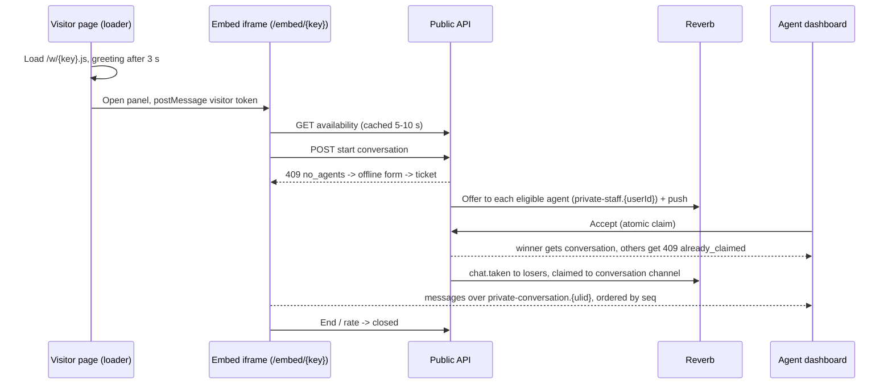
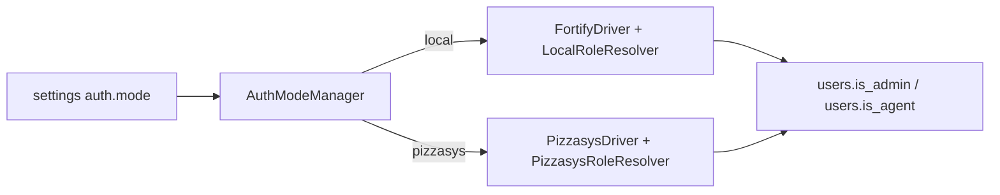

# Architecture

> Status: design (from the approved plan); structure lands in P0/P1, flows in P1-P4.

## Style

Modular monolith on Laravel 13. Business logic lives in `app/Domain/<Context>/Actions` as single-purpose classes. Controllers are thin transports (Inertia, Management API, Public API, Webhooks). Eloquent models stay flat in `app/Models`. Only ULIDs / `public_key` values leave the server; integer primary keys never do. Events use `ShouldDispatchAfterCommit`. Tenant tables carry a nullable `workspace_id` so a SaaS mode is possible later (no tenant UI now: single org, many widgets).

## Contexts

| Context | Responsibility |
|---|---|
| Install | Install state, gate, wizard steps, runner, lock file |
| Settings | Typed, encrypted, Redis-cached settings |
| Auth (`app/Auth`) | `AuthModeManager`, `FortifyDriver`, `PizzasysDriver`, role resolvers, shadow users |
| Catalog | Categories (global; each widget picks which to show) |
| Widgets | Widgets, domains, greetings, draft/publish config |
| Visitors | Visitors, visitor sessions (hashed tokens), signed identity |
| Chat | Conversations, messages, routing, claim, state machine, attachments, ratings |
| Presence | Agent presence, heartbeat, availability |
| Notifications | Web Push, `PushChannel` interface, device tokens |
| WhatsApp | OpenWA sessions, webhooks, hand-off, admin-only inbox (never joined to `conversations`) |
| Analytics | Daily rollups |
| Audit/Outbox | Audit log, outbox events |

Adapters live in `app/Infrastructure/{OpenWa,Nats,Storage,Broadcasting}`.

## Directory layout (target)

```text
app/
  Auth/                      AuthDriver, managers, resolvers
  Domain/<Context>/Actions/  single-purpose actions
  Infrastructure/{OpenWa,Nats,Storage,Broadcasting}/
  Http/Controllers/{Dashboard,Settings,Setup,Embed,Widget,Webhooks,Api/V1/{Public,Management}}/
routes/        setup, dashboard, api_public, api_management, webhooks, channels (.php)
resources/js/  pages, components, hooks, lib, nav, embed, shared
resources/widget/loader/   vanilla-TS IIFE loader (<= 15 KB gz)
docker/  docs/  e2e/
```

Nav is built from `import.meta.glob('./nav/*.ts')` so parallel work tracks never conflict. Each context gets its own ServiceProvider and route file (created in P0).

## Flow 1: visitor to agent chat



The widget opens no websocket until the visitor starts a chat. Eligibility is computed at request time: agents owning the category whose presence is `online` (then `away` after 20 s); queue timeout is 90 s, after which the request becomes an offline ticket. See [realtime.md](realtime.md).

## Flow 2: install gate

- `InstallAwareConfigProvider` forces `session=file`, `cache=file`, `queue=sync`, `broadcast=null` until installed, so nothing touches the database before install. `.env` holds the real drivers, which activate once the lock exists.
- `InstallGate` (global middleware) redirects web requests to `/setup`, returns `503 not_installed` for API calls, and exempts `/up`, `/setup/*` and assets.
- Lock: `storage/app/installed.lock` (authoritative) plus a DB flag. After the lock, `/setup/*` is 404 forever and `/` is `auth`-guarded.
- Takeover guard: one-time `SETUP_TOKEN` printed in the app logs (skipped when `APP_ENV=local`). Non-interactive path: `chat:install --mode=local|pizzasys`.

## Flow 3: auth drivers



The app reads only `users.is_admin` and `users.is_agent`. In mode 1 they are editable; in mode 2 they are derived from pizzasys roles. Details: [auth-modes.md](auth-modes.md).

## Cross-cutting rules

- Dashboard uses Inertia for pages/settings and the Management REST API for live-chat operations, so one API serves web and the future mobile app ([rest-api.md](rest-api.md)).
- WhatsApp is an admin-only domain, never joined to `conversations` ([whatsapp-openwa.md](whatsapp-openwa.md)).
- Widget is a Shadow-DOM launcher plus a React iframe panel; no cookies at all ([widget-embed-api.md](widget-embed-api.md)).
- Contracts (Inertia shared props, event payloads, REST shapes, postMessage protocol) live in `docs/contracts/*`, written before parallel tracks start.
