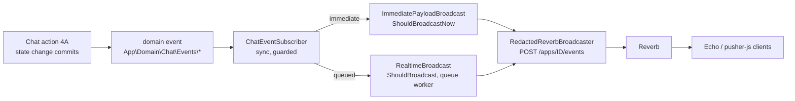

# Realtime

> Status: **implemented in P4 (track 4B)**: channels and their authorisation, the visitor authorisation endpoint, every server event of [contracts/realtime-events.md](contracts/realtime-events.md), failure isolation, the Reverb configuration and the `StaffSessionRevoked` hooks. Presence storage, auto-away and the sweep are documented in "Presence" below (P5, track 5A); push (P5, track 5B) and the WhatsApp admin channel (P6) extend it. Load numbers (about 1k sockets) arrive with the P7 k6 test.
> Contracts: [contracts/realtime-events.md](contracts/realtime-events.md) (channels, events, payloads), [contracts/chat-data-p4.md](contracts/chat-data-p4.md) (domain events and payload classes), [contracts/chat-tracks-p4.md](contracts/chat-tracks-p4.md) (who owns what).

Laravel **Reverb** 1.12 (Pusher protocol, self-hosted) with `laravel-echo` / `pusher-js` on the clients. The **widget opens no websocket until the visitor starts a chat.** Realtime is an add-on to REST: every event also exists as a REST read, clients resync with `GET …/messages?after_seq=N`, and **nothing in the HTTP request that stores a message depends on Reverb being up**.

## How an event gets to a client



- Domain events are `ShouldDispatchAfterCommit` (nothing is broadcast from a rolled back transaction). `RealtimeServiceProvider` subscribes `App\Domain\Chat\Realtime\Listeners\ChatEventSubscriber` to every one of them (a test pins "every class in `app/Domain/Chat/Events` has a listener").
- **Immediate** (published inside the dispatching process, `ShouldBroadcastNow`): `message.created`, `chat.claimed`, `session.revoked`, and `typing`. **Everything else is queued** (`ShouldBroadcast`, 3 tries a second apart, 10 s timeout): a live event that arrives late is worse than none, clients resync over REST.
- Events that describe the **current state** of a conversation (`conversation.updated`, `chat.offered`, `unread.updated`, `offline-ticket.created`) carry only the conversation's ulid and read channels and payload **when the worker handles them**, so late or out-of-order handling still says what is true now, and a conversation deleted in between is not broadcast. `queue.updated` works the same way in one unique job (`BroadcastQueueCounts`, unique until it starts: a burst of changes costs one round of queries; audiences with the same count share one publish).
- Payloads are built from the spine's `App\Data\Chat\*` classes (`v: 1` first), so PHP stays the source of truth for the TypeScript types.
- Queue: the default queue unless `REALTIME_QUEUE` names one (`REALTIME_QUEUE=broadcasts` and `php artisan queue:work --queue=broadcasts,default`). The dev runner (`php artisan dev`) only listens to the default queue, so the default stays `null`.

## Channels and who may join

`routes/channels.php` + `App\Domain\Chat\Realtime\Channels\*`. A channel without an entry is refused: there is no default allow. A client must ask for the right kind (`private-` / `presence-`); the other kind of the same name is refused (`presence-conversation.{ulid}`, `private-staff`, ...).

| Channel | Who | Rule |
|---|---|---|
| `private-staff.{userId}` | that staff member | active account with a chat role, and `userId` is exactly their id (digits only) |
| `presence-staff` | roster of staff | active admin or agent; member info `{id, name, avatarUrl, status}` (stored presence, `offline` if none; no e-mail) |
| `private-conversation.{ulid}` | staff | `ConversationPolicy::viewAsStaff()`: an active admin, the assigned agent, or an agent with an open offer while the chat is `queued` (and, for offline tickets, an agent serving the category). Unknown or malformed ulid: refused |
| `private-conversation.{ulid}` | **visitor** | not here: `POST /api/v1/public/broadcasting/auth` (below) |
| `private-admin` | administrators | active admin |
| `private-whatsapp-admin` | active administrators only (P6) | `WhatsAppAdminChannel`, guards `web` / `sanctum`: an active account with the admin role (with or without the agent role) and the `private-` kind only; agents, visitors, `presence-whatsapp-admin` and every other spelling are refused. Events: "WhatsApp events (P6)" below |
| `private-App.Models.User.{id}` | the kit's notification channel | kept, active owner only |

### Staff: `POST /broadcasting/auth`

Laravel's standard route in the `web` group, so the session cookie goes through the install gate, `session.valid` and `chat.access` like every dashboard request (revoked or deactivated: `401`, no chat role: `403`). All staff channels use the guards `web` and `sanctum`: a **Sanctum bearer** (mobile) works on the same URL. `session.valid` and `chat.access` do not run for a request that has no session, so `StaffAccess` repeats the checks for a bearer: active account, chat role, and the auth driver's session verdict for that token (a token whose portal session was revoked, or whose portal cannot be asked any more, is refused; the token itself is also deleted when the account is deactivated or loses its roles). The answer is the standard Pusher JSON (`auth`, plus `channel_data` for presence).

### Visitors: `POST /api/v1/public/broadcasting/auth`

`Authorization: Bearer vt_…` (the `visitor` middleware; never a cookie or the query string), form or JSON fields `socket_id` (`^\d+\.\d+$`) and `channel_name`. It signs **only** `private-conversation.{ulid}` of the conversation the session is bound to (`VisitorSession::owns()`), the ulid spelled exactly as events are published (lower case).

| Case | Answer |
|---|---|
| valid | `200 {"auth": "key:signature"}` (signed by the configured broadcaster; `Cache-Control: no-store`, no `Set-Cookie`) |
| missing / malformed `socket_id` or `channel_name` | `422 validation_failed` |
| another visitor's conversation, another session's, an unknown ulid, any other channel or spelling | `403 channel_forbidden` (never `404`: a Pusher client treats any non-200 as a refusal) |
| no / unknown token | `401 unauthenticated`; revoked or expired session: `401 session_revoked` |
| Reverb is not the broadcaster (before the install, or no credentials) | `503 realtime_unavailable` |
| too many requests | `429 rate_limited` |

Limiter `broadcasting-auth` (D10): 30 a minute per token (keyed by a hash of what was sent, before it is validated) and 120 a minute per client network (`REALTIME_AUTH_PER_TOKEN`, `REALTIME_AUTH_PER_NETWORK`).

## Server events

Names are dot names (`broadcastAs()`); Echo needs a leading dot (`echoEvent()` in `lib/chat/events.ts`). Every payload carries `v: 1`. **Immediate** is marked; the rest is queued.

| Domain event (4A dispatches) | Broadcast event: channels |
|---|---|
| `ConversationQueued` | `conversation.updated`: admin; `queue.updated` |
| `ChatOffered` | `chat.offered`: `staff.{id}` of each active offered agent (one publish per wave, payload `OfferData`) |
| `ChatTaken` | `chat.taken`: `staff.{id}` of the others (never the winner) |
| `ConversationClaimed` | **`chat.claimed`** on `conversation.{ulid}` (visitor safe: agent `{name, avatarUrl}`); `conversation.updated` |
| `ConversationAssigned` | `chat.assigned`: `staff.{agent}`; `conversation.updated`: admin, new and previous agent |
| `ConversationUpdated` | `conversation.updated`: admin, assigned agent, agents with an open offer (queued), category servers (queued offline ticket) |
| `MessageCreated` | **`message.created`** on `conversation.{ulid}` (visitor safe `MessageData`: no staff id, signed attachment URLs) |
| `MessagesDelivered` | `message.delivered` on `conversation.{ulid}` (`{upToSeq, by, at}`, `by` visitor / agent: that client received the other side's messages up to `upToSeq` without reading them; a `system` receipt is ignored; queued) |
| `MessagesSeen` | `message.seen` on `conversation.{ulid}` (`by` visitor / agent; a `system` receipt is ignored). A read implies delivery: `RecordReceipts` announces a message that was delivered and read in the same call as `message.seen` alone |
| `ConversationEnded` | `conversation.ended` (`ratingRequested`); `conversation.updated` |
| `ConversationClosed` | `conversation.closed`; `conversation.updated` |
| `ConversationTransferred` | `conversation.transferred` on `conversation.{ulid}`; `conversation.updated` also to the agent the chat left |
| `OfflineTicketCreated` | `offline-ticket.created`: admin; `conversation.updated` to the agents serving the category |
| `ConversationRated` | `conversation.rated`: admin |
| `UnseenCountChanged` | `unread.updated`: assigned agent, the absolute counter |
| `QueueChanged` | `queue.updated`: every active staff channel and admin, each with the count it can see (`visibleTo` + `queued`) |
| `PresenceChanged` | `presence.changed` on `presence-staff` |
| `StaffSessionRevoked` | **`session.revoked`** on `staff.{id}` |
| none: the typing endpoints call it | **`typing`**: `TypingBroadcast::dispatch($conversation->ulid, SenderType::Visitor|Agent, bool)` on `conversation.{ulid}`: `{v, actor, typing}`, the REST fallback of the `client-typing` whisper (a server may not publish `client-…`; clients bind both) |

`ConversationAudience` decides who a conversation's change is sent to and is pinned to `ConversationPolicy::viewAsStaff()` by a parity test; accounts that are inactive or lost their chat role are filtered out, so a staff member whose socket is still open after a deactivation stops receiving visitor details.

### Typing

Typing is a **client whisper** (`client-typing`, `{actor, typing}`, debounce 3 s, expire 5 s; Reverb relays it between subscribed members: `accept_client_events_from = members`). It is never stored. The receiver must treat the payload as untrusted input (a visitor controls it). When a client cannot whisper it calls `POST …/typing` and the server publishes `typing`.

## WhatsApp events (P6)

`App\Domain\WhatsApp\Realtime\WhatsAppEventSubscriber` (registered by `WhatsAppServiceProvider`) turns the WhatsApp domain events into broadcasts on **`private-whatsapp-admin` only**: administrators, nobody else, on no other channel. Payloads are the spine's Data classes (`v: 1` first; [contracts/whatsapp-data-p6.md](contracts/whatsapp-data-p6.md)), so no WhatsApp message id, no raw webhook object, no storage path, no secret and **never the QR image** (`session.qrAvailable` / `lastQrAt` say there is one to fetch over REST) can be in them.

| Domain event (dispatched by) | Broadcast: payload |
|---|---|
| `WaMessageReceived` (the webhook job, after the row, an image and the link attempt) | `wa.message.created` `{v, message, chat}` + `wa.chat.updated` `{v, chat}`; the first broadcast already shows the link when the message carried a hand-off code |
| `WaMessageSent` (an administrator's reply was stored, or the phone sent a message itself) | `wa.message.created` + `wa.chat.updated` |
| `WaMessageStatusChanged` (the send job, an ack, `failed`; also a stored image arriving, with `from` equal to the status) | `wa.message.updated` `{v, message}` (merge by `message.ulid`, forward-only) |
| `WaChatLinked`, `WaChatUpdated` (read, archive, a new inbound message re-opening a chat) | `wa.chat.updated` |
| `WaSessionStatusChanged`, `WaSessionQrUpdated` | `wa.session.status` `{v, session}` (`WhatsAppSessionData`, status, number, last error) |

All of them are published inside the process that raised the event (`ShouldBroadcastNow`, the volume is one inbox), and like the live chat's events they are `ShouldRescue`d and wrapped in a `guard()`: **a Reverb that is down is reported and never fails the webhook or the request that caused the event**; the inbox falls back to `GET /whatsapp/chats/{ulid}/messages?after_id=` and `GET /whatsapp/chats`. `WaSessionStatusChanged` also drops the cached availability of the widgets that use the session, so the panel stops offering WhatsApp within seconds of a disconnect.

## When something is down

| Failure | What happens |
|---|---|
| Reverb is down or unreachable | The publish is reported (`report()`, with the signed URL stripped from the message) and the request carries on: the message is stored and returned. Publishes use a 2 s connect / 5 s total timeout (`REVERB_PUBLISH_CONNECT_TIMEOUT`, `REVERB_PUBLISH_TIMEOUT`) |
| The queue is down | The push of a queued broadcast fails inside the listener: reported, the request carries on |
| A payload cannot be built | `ChatEventSubscriber::guard()` reports it; other listeners of the same event still run |
| Reverb is not configured | `broadcasting.default` falls back to `null` (no credentials or host), the visitor auth endpoint answers `503`, `ReverbEndpoint::isAvailable()` is false and 4A leaves the `ws` block out: the panel stays on REST |
| Before the install | `InstallAwareConfigProvider` forces `broadcasting.default = null`; no artisan command touches Reverb |
| A client misses events (drop, tab in the background) | It resyncs with `GET …/messages?after_seq=N` and refetches lists (`updated_after`); counters are absolute |

Tests: `tests/Feature/Realtime/RealtimeFailureIsolationTest.php`.

## Configuration

`config/broadcasting.php` (connection `reverb`, key `realtime`), `config/reverb.php`. Two addresses are involved and differ behind Caddy:

- the **public** one clients connect to: `REVERB_HOST` / `REVERB_PORT` / `REVERB_SCHEME` (`chat.example.com`, `443`, `https`). `ReverbEndpoint::forVisitors()` hands exactly these and the app key to the visitor panel (`ws` block of `POST /public/widgets/{key}/sessions`), never the secret;
- the **internal** one: the Reverb process binds `REVERB_SERVER_HOST` / `REVERB_SERVER_PORT` (default `127.0.0.1:8080`; `0.0.0.0:8080` in the Docker service) and the application publishes to `REVERB_PUBLISH_HOST` / `REVERB_PUBLISH_PORT` / `REVERB_PUBLISH_SCHEME` (default: the public values; in Docker `reverb`, `8080`, `http`).

| Variable | Default | Meaning |
|---|---|---|
| `BROADCAST_CONNECTION` | `reverb` (set it: the example file used `log`) | Falls back to `null` while any of the four below is empty |
| `REVERB_APP_ID`, `REVERB_APP_KEY`, `REVERB_APP_SECRET` | generated by `chat:bootstrap-secrets` | Reverb app credentials |
| `REVERB_HOST`, `REVERB_PORT`, `REVERB_SCHEME` | `localhost`, `8080`, `http` (dev) | Public address (clients) |
| `REVERB_PUBLISH_HOST`, `REVERB_PUBLISH_PORT`, `REVERB_PUBLISH_SCHEME` | the public values | Where the application publishes events |
| `REVERB_PUBLISH_CONNECT_TIMEOUT`, `REVERB_PUBLISH_TIMEOUT` | `2`, `5` (seconds) | Publish timeouts |
| `REVERB_SERVER_HOST`, `REVERB_SERVER_PORT` | `127.0.0.1`, `8080` | Where the Reverb process listens |
| `REVERB_ALLOWED_ORIGINS` | empty | Extra hosts (comma separated) allowed to open a socket, besides the host of `APP_URL` (and loopback when `APP_ENV=local`). **Never `*`**; a bare wildcard entry is dropped. The host saved by the setup wizard is added when `reverb:start` boots (restart Reverb after changing the URL) |
| `REVERB_MAX_REQUEST_SIZE` | `262144` | Largest publish body. A 20 000 character message is JSON-escaped twice (`\uXXXX` per non-ASCII character, about 140 KB): Reverb's own default of 10 000 bytes would reject it (pinned by a test) |
| `REVERB_APP_MAX_MESSAGE_SIZE` | `10000` | Largest message a **client** may send (whispers) |
| `REVERB_APP_PING_INTERVAL`, `REVERB_APP_ACTIVITY_TIMEOUT` | `60`, `30` | Seconds |
| `REVERB_APP_MAX_CONNECTIONS` | unlimited | Per app |
| `REVERB_APP_RATE_LIMITING_ENABLED`, `…_MAX_ATTEMPTS`, `…_DECAY_SECONDS`, `…_TERMINATE` | `true`, `120`, `60`, `false` | Per connection, every incoming frame (a typing indicator every 3 s is about 20 a minute) |
| `REVERB_SCALING_ENABLED`, `REVERB_SCALING_CHANNEL` | `false`, `reverb` | Redis pub/sub between several Reverb instances (uses `REDIS_*`) |
| `REALTIME_QUEUE` | none | Queue of the queued broadcasts |
| `REALTIME_AUTH_PER_TOKEN`, `REALTIME_AUTH_PER_NETWORK` | `30`, `120` | Visitor auth attempts a minute |

`VITE_REVERB_*` mirror `REVERB_HOST` / `PORT` / `SCHEME` for the dashboard's Echo (set in the example file).

## Running it

```bash
php artisan reverb:start --host=127.0.0.1 --port=8312     # the websocket server (dev runner: `php artisan dev` starts it with the config values)
php artisan queue:work            # (or queue:listen) the worker for the queued broadcasts; QUEUE_CONNECTION=sync runs them inline
node e2e/support/realtime-smoke.mjs                      # the real-socket smoke test, see below
```

- **Tests** never open a socket: `phpunit.xml` uses `BROADCAST_CONNECTION=null` and `QUEUE_CONNECTION=sync`; feature tests record what would be published with `Tests\Support\InteractsWithRealtime::recordBroadcasts()` (the whole pipeline runs for real, up to the broadcaster).
- **E2E / dev against a real Reverb**: set `BROADCAST_CONNECTION=reverb`, the `REVERB_*` values above (the public ones must match the port you start Reverb on), `QUEUE_CONNECTION=sync` (or run a worker), start `reverb:start`. The e2e suite owns ports 8110-8129 and 8230-8259; track 4B used web 8302 and Reverb 8312.
- **Smoke test** (`e2e/support/realtime-smoke.mjs`, not part of any default run): starts Reverb and a PHP server, seeds a few rows into the checkout's database (refuses anything but a `chatfeature_p4_*` / `chatfeature_rt*` / `chatfeature_e2e*` database; removes them again), connects a visitor and staff clients with `pusher-js` over real sockets and checks channel authorisation (visitor endpoint and staff bearer), the origin check, every event class, whispers, and that a dead Reverb does not break the dispatching process. It needs `RealtimeServiceProvider` registered in `bootstrap/providers.php`.
- **Production** (Docker + Caddy): proxy `/app/*` (websocket) to the `reverb` service and keep `/apps/*` (the signed publish API) **internal**; run Reverb with `REVERB_SERVER_HOST=0.0.0.0`, `ext-uv`, a raised `nofile` ulimit (one file descriptor per socket, plus headroom: `ulimit -n 65536` / compose `ulimits`), and restart it (`php artisan reverb:restart`) after deploys and URL changes.

## Staff sessions: `StaffSessionRevoked`

`session.revoked` (`role_removed` | `deactivated` | `auth_revoked`) is how an open dashboard learns it must drop its session; 4A also requeues the agent's chats on `deactivated` / `role_removed`. Dispatched where the state changes:

| Place | Reason |
|---|---|
| `UpdateAgent` (mode 1) | `deactivated` when `is_active` goes off, else `role_removed` when `is_agent` goes off |
| `PizzasysRoleResolver::apply` (mode 2, roles recomputed from the portal) | `role_removed` when an agent stops being one (an agent who loses the role loses chat access, so the session revocation below is silent for `no_chat_access`); `auth_revoked` when an admin loses the admin role but stays an agent |
| `ExternalSessionStore::revoke` (every portal session revocation) | `deactivated` for `deactivated`; `auth_revoked` for every other reason except `logout`, `expired`, `no_chat_access` and `upstream_deleted` (silent here, see the other rows) |
| `ExternalIdentityInvalidator::deactivateExternalId` (NATS `user.deleted`) | `deactivated`, once per identity even when no session is open |

A mode 1 deactivation seen by `EnsureSessionIsValid` needs no hook of its own: it already went through `UpdateAgent`. The event is delivered to **all** open tabs of that person (the payload names no session), so a client that gets it checks with REST (`401` means signed out) before dropping everything.

## Presence (P5, track 5A)

An agent's status is `online`, `away` or `offline`. Routing (who is offered a chat, and in which wave), the public `availability.online`, `GET /me/presence`, the `presence-staff` roster, the transfer dialog and the agents page all read ONE store through `EffectivePresence` / `PresenceService`, so they cannot disagree. Code: `app/Domain/Presence/**`, `config/presence.php`; decisions P5-D1..D3 in [contracts/presence-notifications-p5.md](contracts/presence-notifications-p5.md).

### The effective status (`PresencePolicy`)

| Situation | Effective status |
|---|---|
| no record, or the agent chose `offline` | `offline` (a heartbeat never turns it on; only `PUT /me/presence` does) |
| no heartbeat for **90 s** (`presence.heartbeat_window_seconds`; a heartbeat exactly 90 s old still counts) | `offline`: a closed tab, a sleeping laptop |
| a status the agent **pinned** (`PUT {status: away}` or `{status: online}` without `automatic`, `isManual: true`) | that status, while heartbeats keep coming, visible or not |
| **automatic** `online` (`PUT {status: online, automatic: true}`, what the dashboard sends; `isManual: false`), a visible tab beat within `presence.auto_away_minutes` (default **5**; exactly 5:00 already counts) | `online` |
| automatic `online`, every heartbeat of every tab has said `visible: false` for 5 minutes | `away`: routing offers chats to `away` agents from the second wave on |
| the next heartbeat with `visible: true` (any tab), or the agent choosing `online` again | `online` again |

The staff dashboard beats every 30 s (`POST /me/presence/heartbeat {visible}`, `visible` = `document.visibilityState === 'visible'`) and at once when a tab comes back to the foreground; browsers throttle a background tab to about once a minute, which fits the window. A heartbeat from an older client without `visible` counts as visible. With several tabs, one visible tab keeps the agent `online`. Setting `PRESENCE_AUTO_AWAY_MINUTES=0` turns auto-away off.

### Storage (`PresenceStore`)

| `presence.store` | Where the state lives | Cost of a heartbeat |
|---|---|---|
| `redis` (default when `CACHE_STORE`, `QUEUE_CONNECTION` or `SESSION_DRIVER` is `redis`; phpredis client) | one hash `presence:{userId}` (`status`, `manual`, `visible`, `last_heartbeat_at`, `last_visible_at`, `last_seen_at`, `announced`) with a TTL of **2 x the window** (180 s), and one sorted set `presence:alive` scored by the last heartbeat. Prefix `PRESENCE_REDIS_PREFIX`, connection `PRESENCE_REDIS_CONNECTION` (a `database.redis.*` entry) | **one Lua call, O(1), no SQL**. The `agent_presence` row is only a MIRROR, written when the effective status changes (or an agent chooses a status) |
| `database` (default otherwise) | the `agent_presence` row itself (P4 behaviour; never forgets a row) | one UPDATE of the user's row |

The Lua scripts are atomic per user: the heartbeat refreshes the hash and the set, the effective status is computed from what the script returns, and only when it differs from `announced` (the status clients were last told) a second tiny script claims the change, so concurrent heartbeats and the sweep never announce the same change twice. A record that has been silent for 180 s is forgotten: a late heartbeat does not revive it (the agent has to choose a status again; the dashboard shows the "Go online" notice). Everything outside the store stays store-agnostic: `PresenceService::set()` / `heartbeat()` / `reconcile()` end in one `announce()` that dispatches `PresenceChanged` (`presence.changed` on `presence-staff`) and drops the cached public availability of the widgets the agent serves, whatever the change was.

### The sweep (`chat:presence-sweep`, every minute)

Time alone changes an agent's status (silence, auto-away), so the scheduler re-evaluates them: users whose heartbeat is older than the window (the sorted set's range query, in batches of `presence.sweep_batch_size` = 200) and everybody last announced as `online` / `away` (the mirror rows, by id, in batches): each is re-checked, a change is announced once, the mirror is updated. A second run finds nothing to do; `withoutOverlapping(5)` + `onOneServer()` (needs a shared cache: Redis). With the sweep stopped nothing breaks, statuses just change at the next heartbeat or read instead of within a minute (reads always compute the effective status at the time they are asked). The output says what it did: `Checked 5 agent(s): 3 change(s) (3 offline, 0 away, 0 online).`

### When Redis is down

`RedisPresenceStore` throws `PresenceStoreUnavailable` for any Redis failure; `FailoverPresenceStore` answers the call with the database store instead, logs ONE warning (`Presence: Redis is unavailable, the database store answers instead.`) and leaves Redis alone for `presence.failure_cooldown_seconds` (15 s, per PHP process), so no presence call is ever a 500 and a dead host costs one slow connection attempt per cooldown, not one per heartbeat. Meanwhile the table is the truth, with the same rules (heartbeats are one UPDATE each; auto-away and the sweep work on the rows). What agents see: the mirror still holds what each agent chose and the last announced status, so each agent comes back with their next heartbeat (within 30 s); until then a stale mirror row reads `offline`. After Redis returns its records are cold or old: agents who were last seen there long ago read `offline` until they choose a status again, and the next sweep announces it (it walks the mirror, so an agent Redis lost is not left `online` for ever). The mirror write failing (the database down) is logged and does not fail a heartbeat. Redis itself restarting or being flushed has the same effect as the recovery: everybody reads `offline` within a minute and picks `Online` again (one click). Tests: `tests/Feature/Presence/PresenceRedisOutageTest.php`, `PresenceFailoverTest.php`.

### Dashboard

The host sends `visible` with every beat and, after a gap longer than 90 s (a sleeping laptop, a long hidden tab, suspended timers), re-reads `GET /me/presence` once the beat is out, so the selector never keeps saying "Online" for an agent the server already considers offline (the events sent while the socket was down are not replayed). `presence.changed` for anybody is also remembered in the staff store (`seenPresence`, with the time it was heard): the agents page uses it for its status dots and its "N online" figure, whether or not the person is on the roster. With no websocket (polling mode) the dots and the agent's own selector follow the next page load.

## Known limits

- **A socket cannot be closed from the server.** Authorisation happens when a client subscribes. A staff member who is deactivated or demoted keeps an already open socket until it disconnects: the legitimate client drops it on `session.revoked`, events addressed to them are filtered (`ActiveStaff`), but `private-conversation.{ulid}` / `private-admin` events are published to the channel, not to the person. Likewise an agent a chat was transferred away from stays subscribed to its conversation channel (visitor-safe payloads only) until their client unsubscribes. A hard cut-off is `php artisan reverb:restart` (every client reconnects and re-authorises).
- **A visitor's socket outlives its token.** Authorisation happens at subscribe time. When a visitor token is rotated (the previous one lives 60 more seconds), revoked (`DELETE /public/sessions`) or expires, a websocket that is already subscribed to `private-conversation.{ulid}` keeps receiving that conversation's visitor-safe events until it disconnects (and a revoked token cannot subscribe again). The legitimate panel reconnects with the new token; a stolen token's socket is the one that lingers, and what it sees is exactly what the visitor saw. Not changed in this round (the channel scheme stays); closing visitor sockets on revocation, or binding channels to the session, is P7. A hard cut-off is `php artisan reverb:restart`.
- Only the visitor-safe `MessageData` goes over the shared conversation channel; staff-only message fields (the agent's user id) are available over REST only.
- Offer, claim and rating rules live in REST (4A); realtime only announces them.

## Scaling notes

- Redis scaling for several Reverb instances (`REVERB_SCALING_ENABLED=true`); install `ext-uv`; raise the `nofile` ulimit of the Reverb container.
- No socket until a chat starts keeps idle visitors off Reverb; a visitor holds one socket for the length of the chat.
- The queue-count job reads one count per staff member (`Conversation::visibleTo`); fine for tens of agents, revisit with the P7 load test.
- k6 test of about 1k concurrent sockets is planned in P7; results go to [runbook.md](runbook.md).
- See [architecture.md](architecture.md) for the end-to-end flow.

## Sequence, sync, reconnect

- Each conversation has a monotonic `seq` (unique `(conversation, seq)`); sends are idempotent via `client_msg_id`.
- Clients track `lastSeq` and call `GET …/messages?after_seq=N` after a reconnect, a tab visibility change or a detected gap, so no duplicates and no holes.

## Routing and timers, state machine, atomic first accept

Implemented by the Chat actions (4A), announced here: see [contracts/realtime-events.md](contracts/realtime-events.md) (atomic first-accept SQL, timers) and [contracts/chat-data-p4.md](contracts/chat-data-p4.md) (state machine).
